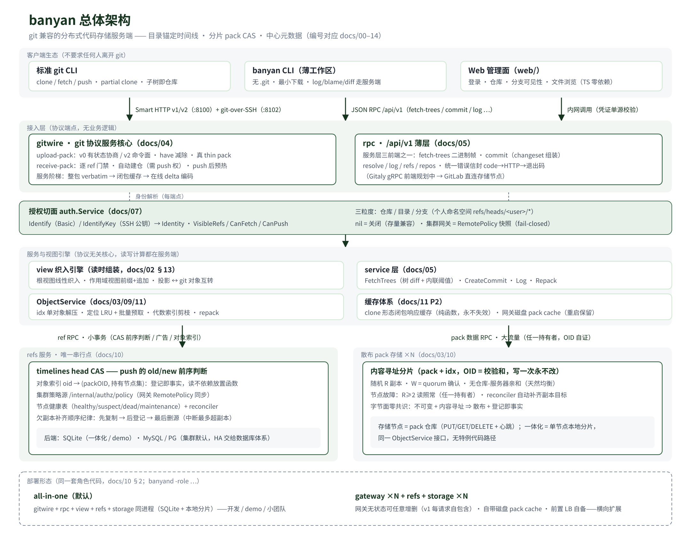

# 00 · 总览：banyan 是什么

## 初衷：为什么做 banyan

**git 是绕不开的行业标准。** 诞生二十余年，git 从个人项目到超大规模企业无处不在，git 工作流早已是整个行业的肌肉记忆，围绕它的工具链、CI 与平台生态无可替代。任何新方案的第一约束由此确定：**不要求任何人离开 git**。

**但 git 并不擅长大型仓库的托管。** Android、Chromium 这类巨型项目早已触到 git 的能力边界：仓库体积以数十 GB 计、对象数以百万计、一次 clone 以小时计。社区用 shallow / sparse / partial clone 缓解症状，但"仓库即单机目录、可达即全量"的底层假设从未改变。

**Monorepo 是企业级代码维护的方向。** 在现代化构建系统（Bazel / Buck 等）之上，**源码依赖是最高效的持续维护方式**——跨包原子变更、无发版延迟、一次提交协同多方。越来越多企业把代码资产收敛进单仓。

**而 Monorepo 必然要求目录级权限。** 单仓共享意味着部门边界、合规隔离、外包可见性都要在**目录粒度**上控制。原生 git 的权限模型止步于仓库粒度；"一个目录拆一个仓库"的模拟又摧毁了 monorepo 的完整性——这是一个原生 Git 无法很好解决的结构性矛盾。

**AI Agent 让矛盾激化。** Agent 对软件开发的渗透持续加深，仓库协作频率从"人天级"跃升到"Agent 分钟级并发"。git 集中式 ref 协作模型（push 锁、全量协商、force push / rebase 级联）的性能瓶颈与协作风险被同步放大。

## banyan 的答案

不推翻 git，而是**重新设计 git 兼容的代码存储服务端**：

- **分布式设计为默认形态**——分片 pack CAS + 中心元数据，存储可横向扩展、不绑定单机，从架构上解决代码这一企业核心资产的存储可靠性问题；
- **目录锚定时间线数据模型**——每个目录拥有自己的提交历史：目录级协作（子目录即仓库、O(子目录) 传输、零跨目录锁）与目录级管理（权限边界即时间线边界）成为**原生能力**，而非外围补丁。

## 远景

让代码存储成为像数据库一样**独立的基础设施层**：任何平台（GitLab / Gitea / 自建）、任何客户端（git CLI / IDE / CI / AI Agent）、任何规模（个人项目到企业 monorepo），都以标准协议访问同一个存储层。banyan 管"代码住在哪里、怎么高效取用"；协作流程归平台，组织与权限归企业——目录时间线把两者的边界对齐在同一粒度上。（定位展开见 [01-big-picture.md](01-big-picture.md)。）

## 一句话

banyan 是一个 git 兼容的服务端版本控制系统：**客户端仍是标准 git，服务端换掉了数据模型与存储架构**——用"目录锚定时间线"替代"单一 root tree 历史"，用"分片 pack CAS + 中心元数据"替代"单机松散对象 + 本地 repack"。

## 为什么这么做：核心设计判断

六条判断贯穿 banyan 的全部设计：

| 判断 | banyan 的做法 |
|---|---|
| 客户端永远在线 → 服务端集中计算 | `banyan` CLI 的读操作全部走服务端 RPC；git 客户端照旧走 wire 协议 |
| 数据结构决定扩展性 | 目录锚定 commit（tree/blob 与 commit 分离），子目录提交 O(子目录大小) |
| ref 是元数据瓶颈 | timeline head 即元数据表一行，CAS 更新 |
| 获取协议应该是"要什么"而非"有什么" | 服务端逐对象批量 RPC（banyan CLI 懒回填）+ git 侧 partial clone filter |
| 不可变内容可无限缓存 | pack 即不可变分片，daemon/cache/server 三层同构缓存 |
| 服务端 ≠ 客户端架构 | 存储节点无状态分片 + 中心元数据单写者 |

第一性约束：**git 服务端不必和 git 客户端一样工作**——对客户端的承诺只有
git wire 协议语义，服务端内部自由重构。

## 总体架构

（矢量源文件 [architecture.svg](architecture.svg)，改图后用
`rsvg-convert -w 2160 -o architecture.png architecture.svg` 重导出。）

五层自上而下，读写计算集中在服务端：

1. **客户端生态**——标准 git CLI（Smart HTTP v1/v2 + git-over-SSH 双传输，
   子树即仓库）、banyan CLI 薄工作区（无 .git，历史在服务端）、Web 管理面；
2. **接入层**——gitwire（git 协议服务核心：有状态 v0 协商 / v2 命令面 /
   thin pack / 服务阶梯）与 rpc `/api/v1` 薄层（三前端之一，Gitaly 规划中）；
   两类端点都只做协议编解码，无业务逻辑；
3. **授权切面**——`auth.Service` 贯穿所有端点：Basic / SSH 公钥同源解析
   身份，VisibleRefs / CanFetch / CanPush 三粒度决策（nil = 关闭；
   集群网关走 refs 策略快照，fail-closed）；
4. **服务与视图引擎**——view 织入引擎（读时组装：根视图 / 作用域视图 /
   投影）、协议无关 service 层、ObjectService（idx 单对象解压、定位 LRU、
   批量预取）、两层缓存（clone 形态闭包响应缓存、网关磁盘 pack cache）；
5. **元数据与字节**——refs 服务是**唯一串行点**（timelines head CAS 前序
   判断 + 对象索引"登记即事实" + 策略源 + 健康表/reconciler）；pack 字节
   散布在无状态存储节点 ×N（内容寻址分片、随机 R 副本 W=quorum、零共识）。

部署形态二选一，同一套角色代码（`banyand -role`）：**all-in-one**（全部
同进程，SQLite + 本地分片——开发/demo）与**集群**（无状态网关 ×N + refs +
存储 ×N——横向扩展，docs/10）。

## 文档地图（总分序）

阅读顺序即设计展开的顺序：

| 段 | 文档 | 一句话 |
|---|---|---|
| **总** | [00-overview](00-overview.md) · [01-big-picture](01-big-picture.md) | banyan 是什么；站在哪里（通用代码存储层 + 平台集成拓扑） |
| **核心设计**（自底向上） | [02-data-model](02-data-model.md) · [03-storage](03-storage.md) · [04-git-compat](04-git-compat.md) · [05-service-api](05-service-api.md) · [06-cli](06-cli.md) | 目录锚定时间线 → 分片 pack 存储 → git 兼容层（HTTP+SSH）→ 服务层与前端 → 薄客户端 |
| **横切能力** | [07-authorization](07-authorization.md) · [08-derived-data](08-derived-data.md) · [09-indexing-packing](09-indexing-packing.md) · [15-workflow](15-workflow.md) | 授权与个人分支可见性；派生数据；索引与打包；目录级高并发工作流（M4） |
| **运行与演进** | [10-ha](10-ha.md) · [11-performance](11-performance.md) · [12-docker-demo](12-docker-demo.md) · [13-testing](13-testing.md) · [14-roadmap](14-roadmap.md) · [16-benchmark-report](16-benchmark-report.md) · [18-gitaly](18-gitaly.md) · [19-gitaly-compat](19-gitaly-compat.md) | 高可用集群；性能与基准门；demo 走查；测试矩阵；里程碑；性能实测报告；Gitaly 集成方案；Gitaly 协议兼容层实现账本 |

## 基座选型：go-git

调研结论（截至 2026-10，go-git main 分支 COMPATIBILITY.md）：

| 能力 | go-git | banyan 用法 |
|---|---|---|
| packfile/idx decode/encode | ✅ | 存储层与 wire 层的编解码底座 |
| 对象模型（blob/tree/commit/tag，SHA-256） | ✅ | model 层的 git 投影直接复用 |
| 协议 v0/v1 客户端 + `transport/server` 服务端 | ✅ | wire 层参考/复用其协商代码 |
| protocol v2 | ✅（2026-10-25，docs/04 §9b/T30） | ls-refs（ref-prefix/peel/symrefs/unborn）+ fetch（段式响应、sideband pack 帧、shallow/filter/ofs-delta）；receive-pack 按语义恒 v0（git 本身如此） |
| 服务端 filter（"Not offered when serving"） | ❌ | **自研**（子目录 clone 的关键） |
| 客户端 `--filter` 懒回填缺失对象 | ❌（可发 filter 请求、记录 promisor 状态，不能按需取回） | `banyan` CLI 自研逐对象批量 RPC 补齐 |
| multi-pack-index / cruft packs | ❌ | 分布式 idx 布局自行定义 |

结论：go-git 当**编解码与协议库**用，不当**框架**用。模型层、存储层、wire 层的核心逻辑自研，接口边界（`MetaStore`、`ShardStore`、`model.*`）全部自有定义，保证 go-git 可替换。

> **v6 main 观察记录（2026-10-16 源码分析）**：未发布的 v6 主干（`github.com/go-git/go-git/v6`，无 release tag）已开始实现 protocol v2——客户端 `Git-Protocol` 头协商、`packp.CommandRequest` 命令帧、fetch 路径均存在（`transport/upload_pack.go`）；但其自带 COMPATIBILITY.md 仍标 v2 ❌（未完成验收），且 v6 **移除了 `transport/server` 整个进程内服务端包**、storer 接口变形（新增 `RawObjectWriter`）、`NewParserWithStorage` 改为 `NewParser(opts)`。Banyan 决策：**锁定 v5.13.0（已发布、集成已验证）**；go-git 依赖隔离已审计（全项目仅 `internal/storage/packfile.go` 一处 import，换版本成本≈改一个文件）；v6 出正式 tag 且 v2 标 ✅ 后再评估迁移，届时收益是 `banyan` CLI 客户端可协商 v2。另：v5.13.0 与 v6 均无 blame 实现（仅有 `object.MergeBase`/`DiffTree`），`derived.Blame` 必须自研。

## 与 git 源码的对照

本仓库设计以 `F:\Workspace\git`（git 源码树）为行为基准，关键对照点：

| git 源码位置 | 行为 | banyan 对应 |
|---|---|---|
| `upload-pack.c` | `uploadpack.allowFilter` 广告 `filter` 能力；v1 会话中解析 `filter <spec>` 行 | gitwire/filter.go：能力广告 + `subtree:<path>` 扩展规格 |
| `receive-pack.c` | ref 命令行 → pack 流 → 解包 → ref 事务更新 → report-status | gitwire/receivepack.go：解包 → 锚定 timeline → head CAS → report-status |
| `http-backend.c` | `/info/refs?service=`、`/git-upload-pack`、`/git-receive-pack` 端点路由 | gitwire/http.go：同端点 + 虚拟仓库路由 |
| `Documentation/technical/partial-clone.adoc` | filtered packfile + promisor remote + 懒取 | rpc/objects.go：逐对象批量获取端点 |
| `Documentation/technical/pack-heuristics.adoc` | pack 组织与 delta 策略 | storage/repack.go：碎片合并与 delta 化策略 |

## 阅读顺序

先读 [02-data-model.md](02-data-model.md)（理解模型分歧点），再读 [03-storage.md](03-storage.md) 与 [04-git-compat.md](04-git-compat.md)（两个承诺：分布式与兼容性），最后 [04](08-derived-data.md)、[05](06-cli.md)、[06](14-roadmap.md)；定位与平台集成看 [01-big-picture.md](01-big-picture.md)。
